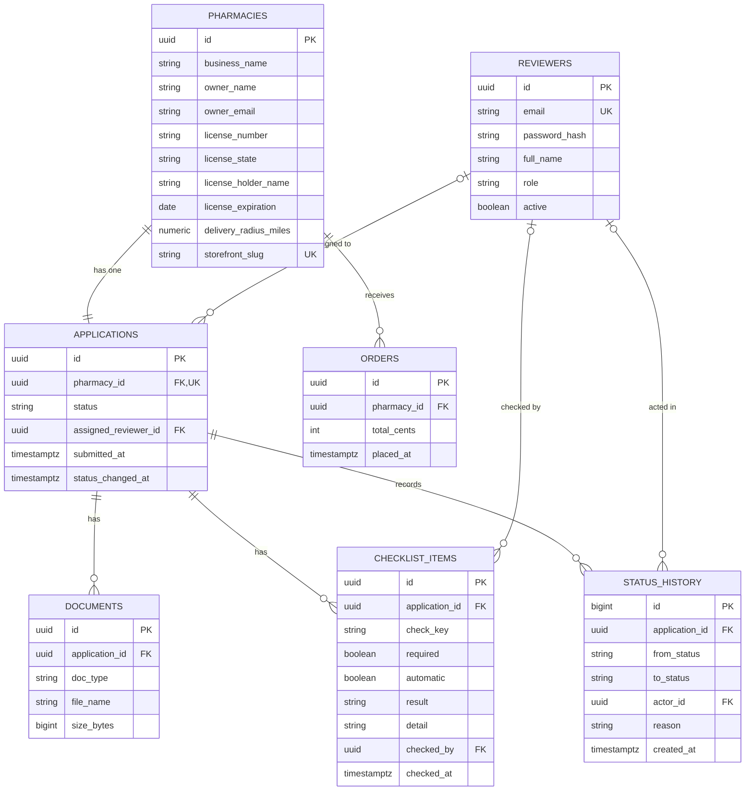
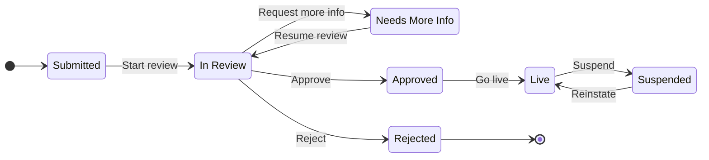

# Meridian Admin Console

Meridian is an internal administration console for a pharmacy delivery platform. It provides operations staff with tools to review pharmacy onboarding applications, verify licenses and documentation, approve pharmacies, manage their activation status, and monitor platform activity.

The project focuses on backend engineering, REST API design, authentication and authorization, relational database modeling, and application workflows.

## Tech Stack

- **Backend:** Java 21, Spring Boot 3.5, Spring Data JPA
- **Database:** PostgreSQL 16, Flyway migrations
- **Security:** JWT authentication, role-based access control
- **API Documentation:** OpenAPI, Swagger UI
- **Frontend:** React 18, TypeScript, Vite
- **Infrastructure:** Docker Compose
- **CI:** GitHub Actions

All project data is synthetic. No real patient, customer, or pharmacy information is used.

## Quick Start

You need Docker with Docker Compose installed.

```bash
docker compose up --build
```

Once the containers are running:

| Service | URL |
|---|---|
| Admin Console | http://localhost:3000 |
| Swagger UI | http://localhost:8080/swagger-ui.html |
| OpenAPI JSON | http://localhost:8080/api-docs |

The initial startup seeds 32 synthetic pharmacies across different application statuses, along with 30 days of order data for live and suspended pharmacies.

Seed data is not duplicated on subsequent restarts.

To reset the application and database:

```bash
docker compose down -v
```

### Demo Accounts

All accounts use the password `Password123!`.

| Email | Role |
|---|---|
| `lead@meridian.test` | Operations Lead |
| `reviewer@meridian.test` | Reviewer |
| `readonly@meridian.test` | Read-Only |

These credentials are intended exclusively for local demonstration.

## Running Without Docker

Requirements:

- Java 21
- Maven
- Node.js 22
- PostgreSQL 16

### 1. Start PostgreSQL

```bash
docker run --name meridian-db \
  -e POSTGRES_PASSWORD=postgres \
  -e POSTGRES_DB=meridian \
  -p 5432:5432 \
  -d postgres:16
```

Create the test database:

```bash
docker exec meridian-db createdb -U postgres meridian_test
```

### 2. Start the Backend

```bash
cd backend
SEED_ENABLED=true mvn spring-boot:run
```

The backend starts on port `8080`.

### 3. Start the Frontend

```bash
cd frontend
npm install
npm run dev
```

The frontend runs on port `5173` and proxies API requests to the backend.

### Environment Configuration

Database configuration is managed through environment variables:

- `DB_URL`
- `DB_USER`
- `DB_PASSWORD`

Defaults are configured to match the local Docker PostgreSQL setup.

The application also requires a `JWT_SECRET` containing at least 32 bytes. A long, randomly generated secret should be used outside local development.

## Application Features

### Pharmacy Onboarding

Operations staff can:

- View and filter pharmacy applications.
- Assign applications to reviewers.
- Review pharmacy and license information.
- Track uploaded documentation.
- Complete manual verification checks.
- Run automated verification checks.
- Request additional information.
- Approve or reject applications.
- Activate approved pharmacies.
- Suspend and reinstate pharmacies.

### Operations Dashboard

The dashboard provides an overview of platform activity, including:

- Pharmacy counts by application status.
- Daily order activity.
- Applications requiring attention.
- Review wait times.
- License expiration warnings.

### Authentication and Authorization

The application uses JWT-based authentication and three user roles:

- **Read-Only:** Can access application information and dashboard data.
- **Reviewer:** Can manage application reviews and verification workflows.
- **Operations Lead:** Has reviewer permissions and additional authority to activate, suspend, and reinstate pharmacies.

Authorization is enforced on the backend rather than relying exclusively on frontend visibility controls.

## Data Model

The database is built around seven primary entities.



Diagram: `docs/er-diagram.png`

Enum-like database fields use `VARCHAR` columns with `CHECK` constraints to enforce valid roles, statuses, checklist results, and document types at the database level.

## Onboarding Workflow

Pharmacy applications follow a controlled state-transition workflow.



Diagram: `docs/state-diagram.png`

Every successful transition creates a corresponding record in `status_history`, capturing:

- Previous status.
- New status.
- User responsible for the action.
- Reason for the transition.
- Timestamp.

Status changes and history records are committed within the same database transaction.

Invalid transitions are rejected with an HTTP `409 Conflict` response.

### Role Permissions

| Action | Read-Only | Reviewer | Operations Lead |
|---|:---:|:---:|:---:|
| View applications and dashboard | Yes | Yes | Yes |
| Submit applications | No | Yes | Yes |
| Attach documents | No | Yes | Yes |
| Run automatic checks | No | Yes | Yes |
| Record manual checks | No | Yes | Yes |
| Start or resume reviews | No | Yes | Yes |
| Request additional information | No | Yes | Yes |
| Approve or reject applications | No | Yes | Yes |
| Activate pharmacies | No | No | Yes |
| Suspend pharmacies | No | No | Yes |
| Reinstate pharmacies | No | No | Yes |

## Verification Checklist

Applications must pass every required verification check before approval.

| Check | Type | Passing Condition |
|---|---|---|
| License number format | Automatic | Matches the expected state and number format |
| License expiration | Automatic | License expiration date is after today |
| Required documents | Automatic | License, business registration, and owner ID are present |
| Delivery radius | Automatic | Greater than 0 and no more than 50 miles |
| Business name verification | Manual | Reviewer confirms the business name matches the license |

Checklist results include `PENDING`, `PASS`, and `FAIL`.

Approval is blocked if any required check is pending or failing. Automatic checks are also re-evaluated during approval to prevent outdated verification results from being used.

Rejecting an application does not require all verification checks to pass.

## API Overview

The backend exposes RESTful endpoints documented through OpenAPI and Swagger UI.

Authentication is performed through `POST /api/auth/login`. The returned JWT can be supplied through the Swagger UI Authorize function.

| Method | Endpoint | Description |
|---|---|---|
| POST | `/api/auth/login` | Authenticate and receive JWT |
| GET | `/api/auth/me` | Retrieve authenticated user |
| GET | `/api/applications` | Retrieve applications with filtering and pagination |
| GET | `/api/applications/{id}` | Retrieve application details |
| POST | `/api/applications` | Submit an application |
| POST | `/api/applications/{id}/documents` | Record an uploaded document |
| POST | `/api/applications/{id}/checks/run` | Execute automatic verification checks |
| PUT | `/api/applications/{id}/checklist/{key}` | Update manual verification result |
| POST | `/api/applications/{id}/transitions` | Execute an application status transition |
| GET | `/api/dashboard/overview` | Retrieve operational dashboard metrics |

Application queue filtering supports:

- Status
- Search query
- Assigned reviewer
- Sorting and sort direction
- Pagination

API errors follow a consistent response structure containing status, error, message, details, and timestamp.

## Backend Architecture and Design Decisions

The backend was independently designed and implemented using Java 21 and Spring Boot.

### State Transition Management

Application transitions are centralized in `TransitionRules.java`.

Rather than distributing workflow conditions across multiple controllers, the application uses a centralized set of transition rules defining:

- Allowed status changes.
- Required user roles.
- Whether a reason is required.
- Whether verification checks must pass.

The service layer evaluates these rules before applying a transition.

### Transactional Status History

Status history is maintained as an append-only record.

Application status changes and their corresponding history entries are committed within the same transaction, ensuring that status updates cannot succeed independently of their audit records.

### Approval Validation

The approval process evaluates all required verification checks.

Pending checks are treated as incomplete, and automatic checks are re-executed during approval to account for information that may have changed during the review process.

### Role-Based Security

Security is enforced through multiple backend layers:

- URL authorization rules in `SecurityConfig`.
- JWT authentication through `JwtAuthFilter`.
- Method-level authorization using `@PreAuthorize`.
- Role validation within application transition services.

The JWT identifies the authenticated user, while current user roles and account status are retrieved from the database.

### Concurrent Application Updates

Application transitions use database row locking through `SELECT ... FOR UPDATE`.

This prevents concurrent requests from applying conflicting status changes to the same application.

### Database Migrations

Flyway manages database schema changes through versioned SQL migration files.

Hibernate uses schema validation rather than automatically modifying the database structure.

This keeps database changes explicit and version-controlled.

### PostgreSQL Integration

The backend uses PostgreSQL for application persistence and testing.

Using PostgreSQL for integration tests allows database constraints, migrations, and SQL behavior to be exercised against the same database technology used by the application.

### Queue Performance

Application queue functionality includes filtering, sorting, pagination, and search.

Sorting uses an approved set of sort fields, and search input is escaped to prevent wildcard characters from unintentionally changing query behavior.

Application and reviewer information are loaded efficiently to avoid unnecessary repeated database queries.

## Testing

Backend tests are located in:

`backend/src/test/`

Frontend tests are located in:

`frontend/src/`

The backend test suite covers:

- Application state transitions and invalid transitions.
- Role restrictions and authorization.
- Required transition reasons.
- Approval validation and incomplete verification checks.
- License format and expiration rules.
- Required document validation.
- Delivery radius validation.
- Authentication failures and invalid tokens.
- Deactivated accounts.
- Application filtering and pagination.
- Search and sorting behavior.
- Dashboard metrics and operational attention rules.

The frontend also includes unit tests for application logic.

## Project Structure

```text
backend/
  src/main/java/com/meridian/admin/
    config/       Security, JWT, and application configuration
    domain/       JPA entities and enums
    repo/         Spring Data repositories
    service/      Business logic and application workflows
    web/          REST controllers, DTOs, and error handling
    seed/         Synthetic demo data

  src/main/resources/
    db/migration/ Flyway migrations

  src/test/       Backend tests

frontend/
  src/pages/      Login, overview, queue, application detail
  src/components/ Shared UI components

docs/
  er-diagram.png
  state-diagram.png

docker-compose.yml
.github/workflows/ci.yml
```

## AI-Assisted Development

Claude (Anthropic) was used as a development aid during this project.

Its involvement was primarily focused on architecture planning and frontend development assistance.

- **Architecture and planning:** Used Claude to explore architectural approaches, organize the application structure, evaluate design decisions, and reason through the overall system design.
- **Frontend development:** Used Claude as an assistant while building the React and TypeScript frontend, including component structure, page layouts, styling, and frontend implementation.
- **Backend development:** The Java/Spring Boot backend was independently implemented by me. This included the database entities, repositories, REST controllers, service layer, business logic, authentication, authorization, database integration, and backend tests.

AI assistance supported the planning and frontend development process, but the backend implementation and its underlying business logic were my own work.

## Known Limitations and Future Improvements

The project currently focuses on internal pharmacy operations. Several features could be expanded in future iterations.

- **Applicant-facing portal:** Pharmacy owners cannot currently submit applications or respond to requests for additional information directly.
- **Reapplication support:** Each pharmacy is limited to one application. Supporting reapplications would require changes to application lifecycle management and database constraints.
- **Authentication hardening:** Login rate limiting, account lockout policies, and refresh token support would improve security.
- **Email notifications:** Add notifications for application status changes and requested documentation.
- **Scheduled license monitoring:** Introduce scheduled checks and notifications for upcoming license expirations.
- **Bulk operations:** Add bulk application actions and CSV export functionality.
- **Audit log interface:** Build a dedicated interface for reviewing application history and administrative activity.
- **Browser testing:** Expand automated testing to cover complete user workflows through the frontend.
- **Scalability:** Move operational attention calculations toward scheduled processing or materialized views as application and order volume increases.

## Continuous Integration

The repository includes a GitHub Actions workflow at `.github/workflows/ci.yml`.

The intended pipeline covers:

1. Backend tests using PostgreSQL 16.
2. Frontend type checking, unit tests, and production builds.
3. Docker Compose stack startup and smoke testing.

**CI status:** [Add verified GitHub Actions run link]